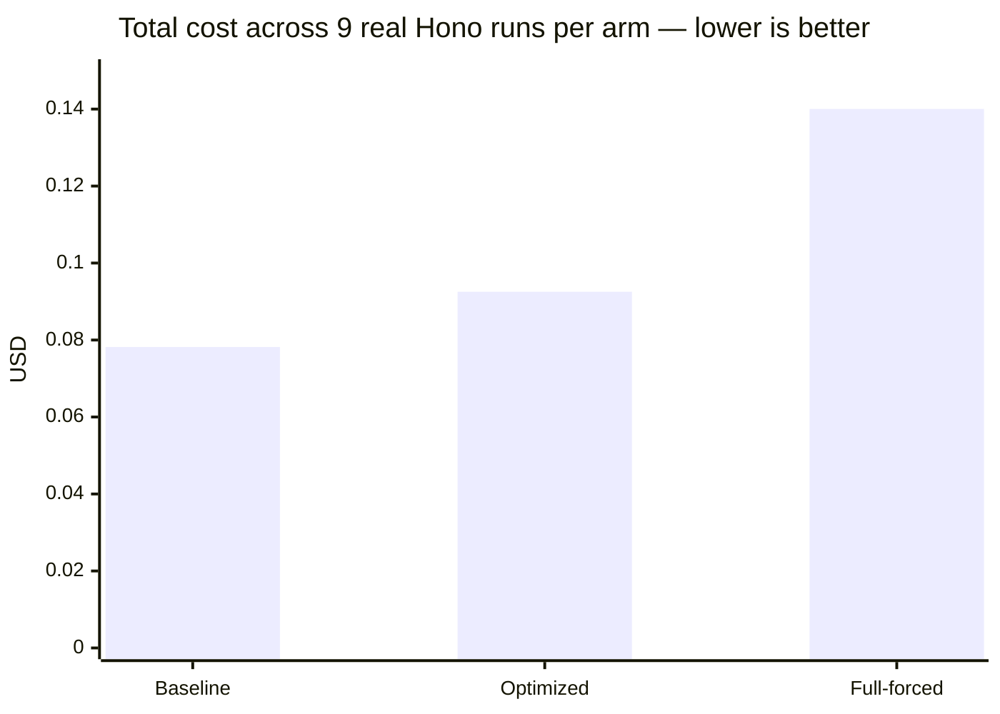
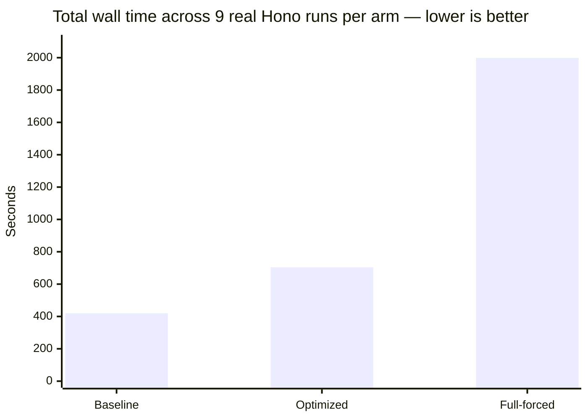

# Real Hono Tool Matrix Benchmark

> **Status:** Experimental · **Last verified:** 2026-11-14 · **Evidence:** 27 isolated Hono runs, 9 tool probes, and one Ralph research run; artifacts under `benchmarks/results/real-hono-tool-matrix-2026-11-13/`

## What this benchmark answers

The benchmark question is tool-neutral:

> Does ToolWright complete the same real tasks correctly at a lower total cost than the stock configuration of the same AI coding tool?

This run answers it for **OpenCode 2.2.7 as the reference adapter** on the real `honojs/hono` repository. It does not measure Claude Code, GitHub Copilot, or ChatGPT/Codex. Those tools need their own stock baseline and equivalent tasks before any cross-tool claim is valid.

The run has three parts:

1. a 27-run code-change matrix on Hono;
2. nine tool-specific probes that force individual capabilities;
3. one Ralph Orchestrator research run in a disposable clone.

## Tested repository and tasks

The benchmark clones `honojs/hono` at commit `f6fbaf0299c48eea9e656e03e2ffe7ac755e8823`. Every run starts from the same prepared template, containing the repository and installed Node dependencies. Both arms receive the same prompt, working directory, and verification command.

The next table defines the three real tasks. **Task** identifies the run; **What the AI was asked to do** is the user-facing change; **Verification** is the command that must pass; **Allowed files** is the scope used to score unrelated changes.

| Task | What the AI was asked to do | Verification | Allowed files |
|---|---|---|---|
| `set-cookie` | Fix the `Context.res` `Set-Cookie` merge bug so middleware and handler cookies both survive, with a regression test. | `pnpm exec vp test --run src/context.test.ts` | `src/context.ts`, `src/context.test.ts` |
| `redirect` | Percent-encode CR and LF in `c.redirect` `Location` headers to prevent header injection, with tests. | `pnpm exec vp test --run src/context.test.ts` | `src/context.ts`, `src/context.test.ts` |
| `request-id` | Add `trustIncoming?: boolean` to the request ID middleware, defaulting to existing behavior, with tests. | `pnpm exec vp test --run src/middleware/request-id/index.test.ts` | `src/middleware/request-id/request-id.ts`, `index.ts`, `index.test.ts` |

These are real tests from the Hono repository, not tests written by the benchmark harness.

The table columns mean:

- **Task** is the benchmark identifier.
- **What the AI was asked to do** is the user-facing behavior, not the implementation.
- **Verification** is the exact command that decides whether the task passed.
- **Allowed files** is the scope used to score unrelated changes.

### Exact prompts sent to the model

The model received these prompts verbatim. The harness did not add hidden task instructions.

**`set-cookie`:**

> Fix the Set-Cookie merge bug in Hono's Context.res setter. When middleware has already set a cookie on c.res and a handler returns a new Response with its own Set-Cookie header, both cookies must survive. Add a regression test in src/context.test.ts. Run pnpm exec vp test --run src/context.test.ts.

**`redirect`:**

> Fix the header injection risk in Hono's c.redirect. Percent-encode CR and LF in the Location header while preserving valid redirect responses. Add regression tests for raw CR/LF and percent-encoded inputs in src/context.test.ts. Run pnpm exec vp test --run src/context.test.ts.

**`request-id`:**

> Add a trustIncoming?: boolean option to Hono's requestId middleware. It must default to true to preserve existing behavior. When false, ignore any incoming request ID header and always use the configured generator while still exposing the generated value through c.get('requestId') and the response header. Add tests for both modes and run pnpm exec vp test --run src/middleware/request-id/index.test.ts.

The `full-forced` arm appends this instruction:

> Before editing, use Serena semantic tools to locate the relevant symbols. Use ast-grep from the shell for structural search. Load the systematic-debugging skill. After implementing, ask the code-reviewer subagent to review the diff. In your final response, list which tools and subagents you used.

## Benchmark arms

The next table defines the three arms. **Arm** is the label; **Configuration** is what the run loaded; **Agent** is the primary agent; **Tool policy** explains what the arm was allowed or instructed to use.

The columns are **Arm** (comparison label), **Configuration** (loaded OpenCode/project configuration), **Agent** (primary agent), and **Tool policy** (what the arm was allowed or told to use).

| Arm | Configuration | Agent | Tool policy |
|---|---|---|---|
| `baseline` | Stock OpenCode config | `build` | Default OpenCode tools only; no project MCP servers |
| `optimized` | ToolWright minimal profile | `coordinator` | ToolWright instructions, Serena, CodeGraph, and the project skills/commands |
| `full-forced` | ToolWright minimal profile | `coordinator` | Same as optimized, plus explicit instructions to use Serena, ast-grep, the systematic-debugging skill, and the code-reviewer subagent |

`full-forced` is intentionally aggressive. It tests whether using every capability is economical, not whether the model would choose those tools on its own.

## Results

The next table reports median cost and median wall time for each task and arm. A median is the middle value of three runs. **Cost** is API spend from the per-run session log; **Wall** is elapsed seconds; **Score** is the correctness score defined below; **Verify** is passing runs out of three.

The columns are **Task** (benchmark identifier), **Arm** (comparison label), **Cost** (median API spend across three runs), **Wall** (median elapsed seconds), **Score** (correctness score below), and **Verify** (passing runs out of three).

| Task | Arm | Cost | Wall | Score | Verify |
|---|---|---:|---:|---:|---:|
| `set-cookie` | baseline | $0.015517 | 75s | 4 | 3/3 |
| `set-cookie` | optimized | $0.018774 | 126s | 4 | 3/3 |
| `set-cookie` | full-forced | $0.024514 | 304s | 4 | 3/3 |
| `redirect` | baseline | $0.005694 | 42s | 4 | 3/3 |
| `redirect` | optimized | $0.006204 | 58s | 4 | 3/3 |
| `redirect` | full-forced | $0.013427 | 186s | 4 | 3/3 |
| `request-id` | baseline | $0.002667 | 17s | 4 | 3/3 |
| `request-id` | optimized | $0.003709 | 33s | 4 | 3/3 |
| `request-id` | full-forced | $0.011165 | 135s | 4 | 3/3 |

The next table aggregates all nine runs per arm. **Cost** and **wall** are sums across nine runs. **Tokens** is input plus output. **Change** compares each arm with baseline.

The columns are **Arm**, **Runs** (number of executions), **Total cost** and **Cost change** (sum and percentage versus baseline), **Total wall** and **Wall change** (sum and percentage), **Tokens** and **Token change** (input plus output), and **Score 4** (runs with the maximum correctness score).

| Arm | Runs | Total cost | Cost change | Total wall | Wall change | Tokens | Token change | Score 4 |
|---|---:|---:|---:|---:|---:|---:|---:|---:|
| `baseline` | 9 | $0.078202 | — | 419.5s | — | 269,937 | — | 9/9 |
| `optimized` | 9 | $0.092539 | +18.3% | 704.0s | +67.8% | 221,329 | −18.0% | 9/9 |
| `full-forced` | 9 | $0.140033 | +79.1% | 1,998.4s | +376.4% | 322,691 | +19.5% | 9/9 |

All 27 verification commands passed, and every run scored 4/4. The optimized arm used **18.0% fewer tokens** than baseline but cost **18.3% more**. The reason is visible in the token mix: optimized input fell, but output and reasoning rose sharply.

## Charts

The first chart compares total cost across the nine runs in each arm. The horizontal axis names the three arms. The vertical axis is **US dollars**, from $0 to $0.15. Each bar is the sum of nine runs. Lower is better. The chart is not a per-task view; it shows the aggregate economic result.



The second chart uses the same arms but compares total wall time. The vertical axis is **seconds**, from 0 to 2,100. Each bar is the sum of nine runs. Lower is better. Wall time includes model latency, reasoning, tool execution, and MCP startup.



## Tool coverage

The next table records what was actually observed in the matrix, not what was merely installed. **Capability** names the tool or feature; **How it was exercised** describes the run or probe; **Observed evidence** is the session-level count or output.

The columns are **Capability** (tool or feature), **How it was exercised** (matrix or probe), and **Observed evidence** (session-level count or output).

| Capability | How it was exercised | Observed evidence |
|---|---|---|
| OpenCode native `read`, `grep`, `glob`, `shell` | Matrix tasks | Used in all arms |
| OpenCode native `edit` | Baseline matrix | 25 edit calls |
| OpenCode native `write` | Write probe | Not available to the coordinator; see below |
| `todowrite` | Matrix + probe | 5 calls in optimized, 3 in full-forced, 1 in probe |
| Serena MCP | Full-forced matrix + probe | 163 Serena execute calls in full-forced |
| CodeGraph MCP | Optimized matrix + probe | 9 CodeGraph calls in optimized |
| ast-grep | Full-forced matrix + probe | 27 shell commands containing `ast-grep` |
| `systematic-debugging` skill | Full-forced matrix + probe | 9 `skill` calls in full-forced |
| `code-reviewer` subagent | Full-forced matrix + probe | 11 `subagent` calls in full-forced |
| Memory plugin | Memory probe | Exact title `BenchmarkMemory` returned |
| Slash command `/review` | Command probe | Review output produced; command expansion unverified |
| Ralph Orchestrator | Isolated research run | 2 iterations, completion promise detected, 176.2s |
| `toolwright` deterministic commands | Local checks | `doctor`, `profile verify`, `eval`, `verify`, `govern contracts`, `catalog verify --check-drift` passed |

## Tool probes

Tool probes are capability checks, not repeated cost benchmarks. Each probe runs once and records whether the tool was actually invoked and produced a usable result.

The columns are **Probe** (capability tested), **Cost** (API spend for the single probe run), **Steps** (model/tool iterations), and **Evidence** (what the session shows was actually used).

| Probe | Cost | Steps | Evidence |
|---|---:|---:|---|
| Serena semantic mapping | $0.011540 | 27 | 26 Serena `execute` calls; symbol and flow output |
| CodeGraph exploration | $0.005960 | 5 | 3 `codegraph_explore` calls; affected test files returned |
| ast-grep structural search | $0.011426 | 15 | 18 `ast-grep` shell commands; matching files and lines |
| `systematic-debugging` skill | $0.003480 | 6 | `skill` tool call; workflow output |
| `code-reviewer` subagent | $0.003758 | 7 | `subagent` tool call; reviewer findings |
| Memory plugin | $0.000621 | 1 | Model returned `BenchmarkMemory` |
| `/review` command | $0.019092 | 19 | Review produced; command expansion not verified |
| Write-tool limitation | $0.001093 | 3 | Coordinator reported no `write` tool; optimized uses shell |
| `todowrite` | $0.000762 | 2 | `todowrite` tool call |
| Ralph research | — | 2 iterations | `RESEARCH_COMPLETE`/completion promise detected; 176.2s; no source edits |

Across the nine probes, the total measured cost was **$0.057732**. That is a coverage cost, not a representative task cost.

The command probe exposed a CLI limitation: `opencode run` passes `/review ...` to the model as literal text instead of expanding the slash command. Command execution needs a TUI or API test, so it is reported as unverified.

The write probe exposed a configuration limitation that matters for quality: the coordinator reports no `edit` or `write` tool. It can still change files through `shell`, which is what the optimized matrix runs did. The baseline uses `edit`, but does not use `write` in these tasks. This is a design trade-off, not a missing measurement: the coordinator is intentionally restricted, and shell edits are harder to audit than structured edit calls.

## Ralph Orchestrator probe

Ralph ran a read-only research task in a disposable Hono clone with an isolated config and a local research hat collection:

```text
iterations: 2
elapsed: 176.2s
result: completion promise detected
source edits: none
```

Ralph performed the known 2.10.1 automatic commit during landing (`422b777`), which is why it must run in a disposable clone. It did not modify source files for this research prompt. Its cost was not captured in the same per-run session format as the OpenCode matrix, so the table reports iterations and wall time rather than inventing a cost.

## Quality

Quality means two things in this benchmark:

1. the task's real test command passed;
2. the diff stayed inside the allowed file set.

All 27 matrix runs pass the first condition. The second condition also passed for every clean-matrix run after excluding ToolWright-managed directories (`.opencode/`, `.ralph/`, `.serena/`, `.codegraph/`, `.toolwright/`, and the lock file). No run received a score below 4.

This is **not** independent code review. The benchmark did not run a blind reviewer outside the agent session, did not audit every acceptance criterion manually, and did not measure human rework after the fact. Those remain limitations.

## Interpretation

The clean real-repository result is consistent with the earlier example result:

- ToolWright reduced input tokens and tool-schema traffic.
- It increased output and reasoning tokens.
- The net effect was higher cost and much higher wall time.
- Forcing every tool made the result substantially worse.

The `full-forced` arm used Serena, CodeGraph, ast-grep, the skill, and subagents, but cost **79.1% more** and took **376.4% longer** than baseline. Using all tools is not a cost optimization strategy for these small, well-scoped tasks.

The optimized arm is a better default than full-forced, but it still does not beat stock OpenCode on cost for this task set.

## Deterministic CLI checks

The following repository tools were verified without model calls:

```text
toolwright doctor --json             -> exit 0
toolwright profile verify            -> exit 0
toolwright eval                      -> exit 0
toolwright verify                    -> 3 passed
toolwright govern contracts          -> exit 0
toolwright catalog verify --check-drift -> exit 0 (PyYAML environment)
```

These checks validate the toolkit's deterministic surfaces; they do not measure coding quality.

## Limitations

- One real repository: Hono.
- One model: `deepseek/deepseek-flash`.
- Three repeats per task and arm.
- `full-forced` is a deliberately exaggerated arm, not a recommended default.
- Tool probes run once; they are coverage checks, not statistical results.
- Slash-command execution is unverified because `opencode run` does not expand `/review`.
- Ralph result is a research workflow, not a code-change workflow.
- No independent blind review or post-run human rework measurement.
- Claude Code, GitHub Copilot, and ChatGPT/Codex were not measured.

## Artifacts

Matrix and probe artifacts are under `benchmarks/results/real-hono-tool-matrix-2026-11-13/`. Each run contains its prompt, session log, per-run stats, verification log, status, diff, and notes where applicable.
